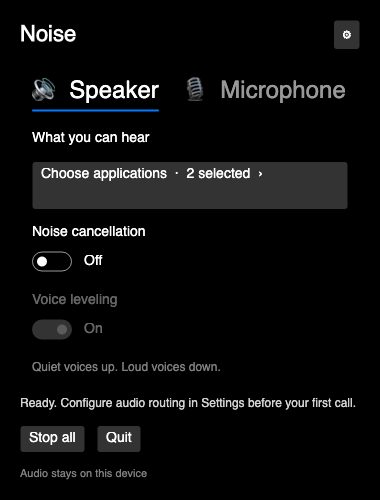

<p align="center">
  
</p>

<h1 align="center">Noise</h1>
<p align="center"><strong>Clear calls. Both ways.</strong><br>
Noise cancellation for the apps you hear and the microphone others hear.</p>
<p align="center">
  <a href="https://github.com/mvs2403/Noise/releases/download/v0.1.0/Noise-0.1.0-apple-silicon.dmg"><strong>Download for Mac</strong></a>
  · <a href="https://github.com/mvs2403/Noise/releases/tag/v0.1.0">Release files</a>
  · <a href="#quick-start">Quick start</a>
  · <a href="docs/DEVELOPMENT.md">Developer guide</a>
</p>
<p align="center">macOS 14.2+ · Windows 11 x64 · Private beta</p>

Noise processes call audio locally on your device. Clean the sound arriving from
Teams, Zoom, a browser, or several apps together, and optionally send a cleaned
microphone to your call app. Each direction has independent controls.

## Downloads

| Platform | Package | Setup |
| --- | --- | --- |
| macOS 14.2+, Apple Silicon | [DMG · 0.1.0](https://github.com/mvs2403/Noise/releases/download/v0.1.0/Noise-0.1.0-apple-silicon.dmg) | [Mac quick start](#quick-start) |
| Windows 11, x64 | [Installer · 0.2.0](https://github.com/mvs2403/Noise/releases/download/v0.2.0/Noise-0.2.0-windows-x64-setup.exe) · [Portable ZIP](https://github.com/mvs2403/Noise/releases/download/v0.2.0/Noise-0.2.0-windows-x64.zip) | [Windows routing guide](docs/WINDOWS.md) |

Windows uses installed virtual audio devices. Two independent cable pairs are
needed for both directions together; drivers are installed separately. The
installer includes the filters and .NET runtime and is unsigned. Download links
require access to this private repository. The screenshots and Mac instructions
below show the native macOS app; Windows has a matching two-tab tray panel.

<p align="center"></p>

*Desktop panel preview with sample app selection.*

<table>
  <tr>
    <th>Speaker · What you hear</th>
    <th>Microphone · What they hear</th>
  </tr>
  <tr>
    <td align="center"></td>
    <td align="center"></td>
  </tr>
</table>

*Screenshots show the native interface with sample app and device labels.*

## What it does

- **Clean incoming audio.** Select one or more applications. Their audio shares
  one filter; other apps keep playing normally.
- **Clean your microphone.** Send processed speech through **Noise Microphone**,
  the optional virtual microphone selected inside your call app.
- **Keep volume steadier.** Voice leveling raises quiet speech and softens loud
  speech after filtering. It stops with cancellation and remembers your choice.
- **Adjust reduction live.** A 0–100% slider appears beneath cancellation in the
  menu bar while enabled. Each direction remembers its own strength.
- **Follow your Mac's speakers.** **Follow Mac output** is the default. Switching
  the macOS output reconnects Noise to the new device. A fixed override is available.
- **Stay out of the way.** Close the main window and keep using the menu bar,
  without a Dock icon. Quit from the panel's power button.

DPDFNet is the default engine. Settings also offers DeepFilterNet3, RNNoise, and
an experimental automatic **Main speaker** mode. No voice enrollment is needed.

## Install

1. Sign into GitHub with an account that has access to this private repository.
2. Download the [Apple Silicon DMG](https://github.com/mvs2403/Noise/releases/download/v0.1.0/Noise-0.1.0-apple-silicon.dmg).
3. Open it and drag **Noise.app** to **Applications**.
4. Eject the disk image, then open Noise from Applications. Look for its waveform
   icon in the macOS menu bar.

All engines and models are bundled. You do **not** need Xcode, Python, Rust, or
additional model downloads to use the app. A ZIP is available among the
[release files](https://github.com/mvs2403/Noise/releases/tag/v0.1.0).

> **Private beta signing:** this build is ad hoc signed and is **not notarized**.
> macOS may block its first launch. After trying to open it, follow Apple's
> per-app [Open Anyway instructions](https://support.apple.com/102445) in
> **System Settings → Privacy & Security**, if that option is available.
> See the [distribution guide](docs/DISTRIBUTION.md) for signing status and checksums.

## Quick start

### Clean what you hear

1. Open Noise's waveform menu-bar icon and select the **Speaker** tab.
2. Click the large applications button. Check the apps you want, then **Done**.
   **Use current app** adds the last active app outside Noise; **Pick a window…**
   lets you choose an app by clicking its window or Dock icon.
3. Turn **Noise cancellation** on and allow **System Audio Recording** when
   macOS asks. If the selected apps are idle, Noise waits for their audio.
4. Adjust **Noise reduction** underneath the switch. Enable **Voice leveling**
   for steadier speech volume.


Selections are remembered, including closed apps. Selecting a browser includes
audio across all its tabs. Before macOS 26, an app may need to play audio before
Core Audio exposes it for capture.

**Follow Mac output** routes to the currently selected macOS headphones or
speakers. Change the Mac's output as usual; Noise reconnects automatically with
a brief transition. The main window's **Listen through** selector also allows a
fixed output when you deliberately want one.

Turning incoming cancellation off restores the selected apps' original audio.

### Clean what they hear

1. Open **Noise Settings → Outgoing microphone → Set Up Virtual Microphone**.
   This optional, one-time installation requires administrator access and briefly
   restarts audio. Set it up **before joining a call**.
2. In Noise's main window, choose your physical microphone under **Your microphone**.
3. In Teams, Zoom, or the other call app, select **Noise Microphone** as its input.
4. Open the menu-bar **Microphone** tab and turn cancellation on. Adjust its
   reduction strength and leveling independently of the Speaker tab.

Turning microphone cancellation off passes your original voice through the
virtual microphone. **Stop All** or quitting Noise stops that route completely.
Return the call app to your physical microphone before stopping or quitting.


Headphones help avoid speaker-to-microphone feedback. Keep the call app's acoustic
echo cancellation available; noise suppression does not replace it.

## Choose voices and engines

In **Settings**, choose independently for incoming audio and your microphone:

| Mode | Behavior |
| --- | --- |
| **All voices** | Reduce room noise while retaining speech from everyone. Uses your chosen DPDFNet, DeepFilterNet3, or RNNoise engine. |
| **Main speaker · Experimental** | Automatically favor the dominant foreground voice and reduce quieter background voices using Hush. No sample or saved identity is required. |

Main speaker is useful to try when one voice is clearly stronger or nearer the
microphone. It can also soften the intended voice or retain competing talkers.
Similar-volume voices, heavy overlap, and calls that already equalized everybody
are difficult. It cannot recover individual meeting-participant tracks from an
app's combined audio.


| Engine | Intended option |
| --- | --- |
| **DPDFNet · Default** | Full-band speech enhancement at 48 kHz |
| **DeepFilterNet3** | An alternative full-band speech enhancer at 48 kHz |
| **RNNoise** | A lightweight speech denoiser at 48 kHz |
| **Hush · Main speaker** | Automatic foreground speech enhancement at 16 kHz speech bandwidth |

Use **Open Noise → Original / Cleaned** to compare while a path is running.
Original bypasses all effects. Switching engines or voice modes reconnects that
path. Lower strength blends more original sound back in; higher strength applies
more of the selected filter. Overlapping voices are leveled as a combined signal.

## Privacy and permissions

Processing runs on this Mac. Noise does not record, transcribe, or upload calls.
Incoming filtering needs **System Audio Recording** permission; outgoing
filtering also needs **Microphone** permission. The optional virtual driver asks
for administrator access only during installation/removal.

Noise does not change the Mac's default input or output. Follow Mac output
observes the existing selection. Hiding menu-bar controls in Settings restores a
Dock icon so the running app remains reachable.

## Troubleshooting

| Symptom | Check |
| --- | --- |
| Selected apps are silent or show a connection wait | Respond to any pending macOS audio-recording permission dialog, even if Noise already has a checked entry in Privacy & Security. |
| No app appears in the chooser | Open it, start audio playback, and use Refresh Apps & Devices in the main window. |
| Noise Microphone is missing | Install it from Settings, then refresh devices. macOS may need a sign-out/restart if its audio service has not registered the driver. |
| Call participants cannot hear you after quitting | Select your physical microphone in the call app; the virtual microphone is silent while Noise is not feeding it. |
| Filtering struggles or affects the voice | Try All voices, reduce strength, or compare another engine. Main speaker is experimental. |
| The waveform icon is hidden | Check the menu bar's overflow area or reopen Noise; show menu-bar controls in Settings. |

To remove the optional driver, first return call apps to a physical microphone,
quit Noise, then run the included uninstaller. It asks for administrator access
and briefly interrupts audio:

```sh
sudo /bin/bash /Applications/Noise.app/Contents/Resources/uninstall_microphone.sh
```

Remove Noise.app from Applications afterward.

## Development and release status

This is a development beta. Processing is mono and intended for speech, including
all sound from selected apps. Music, shared videos, and notifications from those
apps are filtered too. Background voices and distortion can remain.

**28 automated audio tests pass.** Local checks cover engine streaming, reduction
strength, leveling, peak protection, queue integrity, multi-app selection,
foreground sessions, and output-routing policy. Two local apps have played through
a shared incoming route. Live Teams routing, administrator driver installation,
and changing hardware outputs during a live call still need hands-on validation.
These checks do not establish speech quality across calls.

```sh
git clone https://github.com/mvs2403/Noise.git
cd Noise
./script/build_and_run.sh --verify
```

Building needs an Apple Silicon Mac, Xcode with Swift 6+, and Python 3.12+.
The first build fetches pinned dependencies; subsequent use works offline.

- [Developer guide](docs/DEVELOPMENT.md): build commands, tests, DSP behavior and architecture.
- [Distribution guide](docs/DISTRIBUTION.md): packaging, checksums, private access and signing.
- [Release notes](docs/releases/0.1.0.md): what is included in this beta.
- [Third-party notices](THIRD_PARTY_NOTICES.md): upstream projects, revisions and licenses.

The separately bundled Noise Microphone driver is derived from BlackHole and is
GPL-3.0. Its source and build scripts are included in the repository and matching
release source archive. Upstream models and runtimes retain their own licenses;
license texts are included inside the app.
